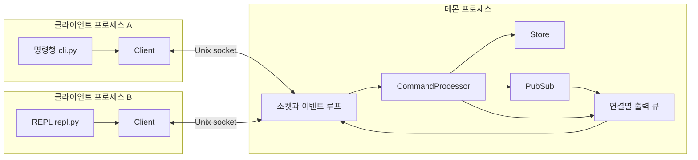
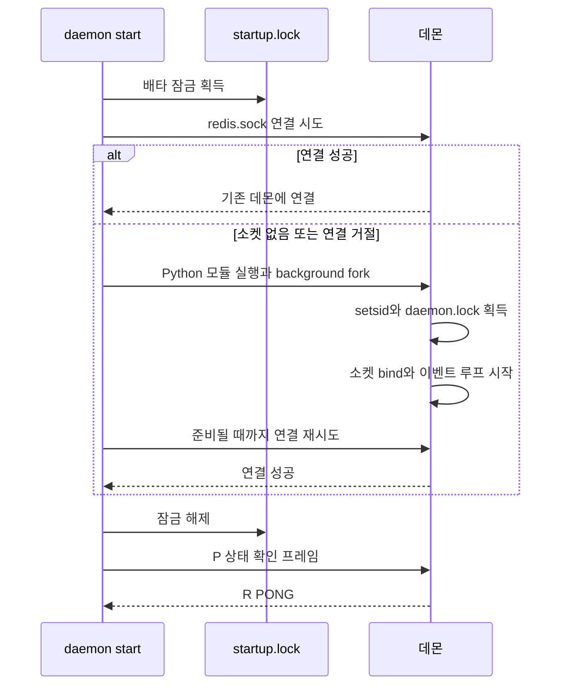
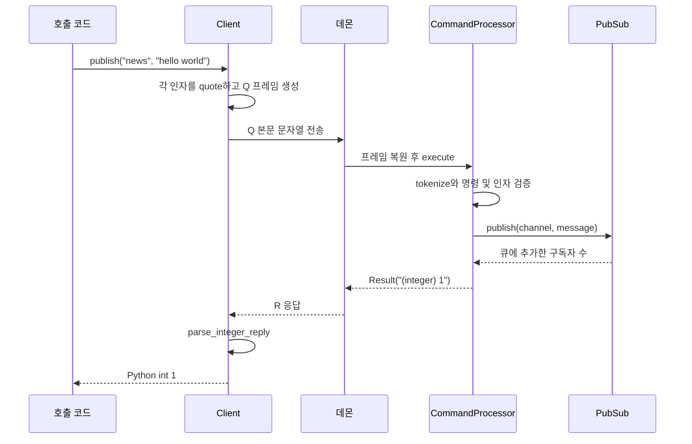
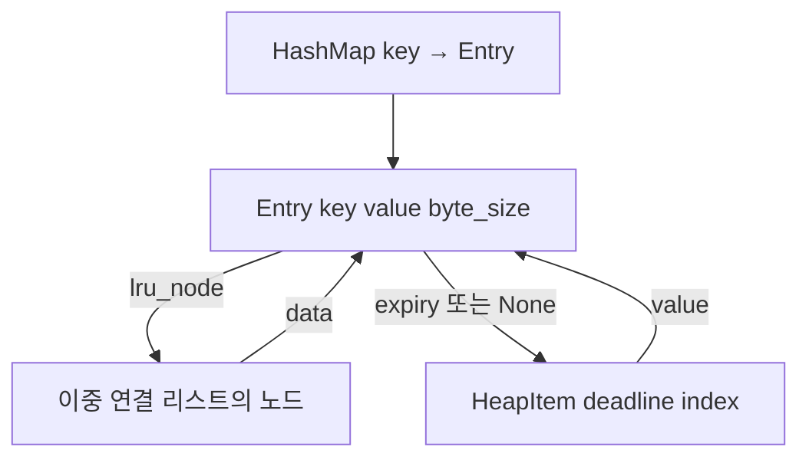
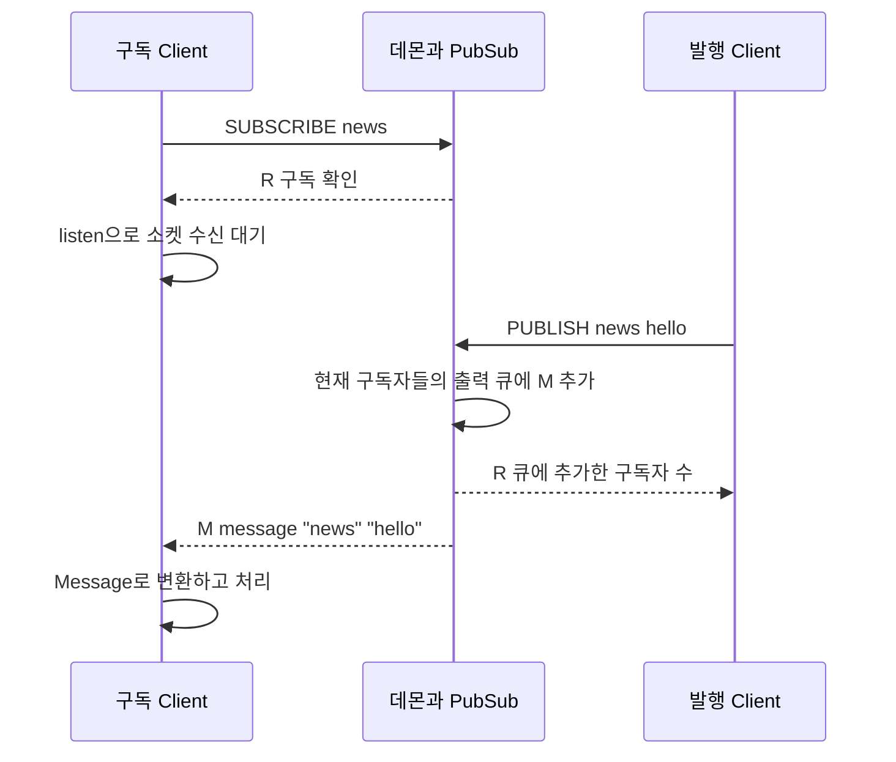

# mini_redis 아키텍처

mini_redis는 직접 구현한 자료구조를 사용하는 메모리 저장소를 하나의 데몬 프로세스에 두고, 여러 로컬 클라이언트가 Unix domain socket으로 접근하는 구조다. 데몬이 서버이며, 명령행과 REPL은 같은 `Client`를 사용하는 두 가지 사용자 인터페이스다. 저장된 데이터와 구독 상태는 데몬의 메모리에 존재한다.

파일별 함수와 구현 알고리즘은 [코드 해설](CODE_GUIDE.md)에 정리되어 있다. 이 문서는 프로세스 경계, 통신 흐름, 상태 관리, 실제 Redis와의 차이를 설명한다.

## 구현 범위

[과제](../subject.html)의 필수 기능인 문자열 저장, 메모리 제한, LRU 제거, TTL과 보너스 Pub/Sub을 구현한다. 핵심 자료구조는 내장 `dict`, `set`, `collections` 대신 직접 만든 해시맵, 이중 연결 리스트, 최소 힙을 사용한다. Python `list`는 해시 버킷과 힙의 인덱스 저장 공간으로 사용한다.

데몬과 로컬 IPC는 서로 다른 CLI 실행에서도 저장소를 공유하기 위한 확장이다. 네트워크 서버, 디스크 영속화, 트랜잭션, 복제, 클러스터는 현재 구현 범위에 포함되어 있지 않다. `fcntl`, `os.fork`, Unix socket과 터미널 제어를 사용하므로 실행 구조는 Unix 계열 환경을 전제로 한다.

## 프로세스와 계층



`Client`는 클라이언트 프로세스 안에서 실행되는 Python 객체다. 별도의 Client 프로세스를 추가로 띄우는 구조가 아니다. `Client.publish("news", "hello")`는 현재 프로세스에서 호출되고, 실제 구독자 탐색과 메시지 배포는 데몬에서 수행된다. 이 API를 제공하기 위해 별도 배포용 Python 패키지를 만드는 것도 필요하지 않다.

| 계층 | 담당 코드 | 책임 |
| --- | --- | --- |
| 진입점과 명령행 | [main.py](../main.py), [cli.py](../mini_redis/cli.py) | 인자 처리, 데몬 제어, 한 번 실행하는 명령과 REPL 선택 |
| 대화형 입력 | [repl.py](../mini_redis/repl.py) | 입력 편집, 화면 출력, 입력 중 구독 이벤트 표시 |
| 클라이언트 | [client.py](../mini_redis/client.py), [responses.py](../mini_redis/responses.py) | 연결, 요청 전송, 응답과 이벤트 분리, Python 값 반환 |
| 전송 | [protocol.py](../mini_redis/protocol.py) | 프레임 경계, 길이 제한, UTF-8 인코딩과 디코딩 |
| 서버 실행 | [daemon.py](../mini_redis/daemon.py), [runtime.py](../mini_redis/runtime.py) | 프로세스 수명, 잠금, 소켓, 비동기 입출력 |
| 명령 처리 | [commands.py](../mini_redis/commands.py) | 명령 파싱, 인자 검증, 저장소와 브로커 호출 |
| 데이터와 구독 | [store.py](../mini_redis/store.py), [pubsub.py](../mini_redis/pubsub.py) | 키, LRU, TTL, 메모리 통계, 채널과 구독자 |

저장소는 소켓이나 터미널을 모르고, 전송 계층은 `SET`이나 `PUBLISH`의 의미를 모른다. 다만 현재 응답 본문은 표시용 문자열이므로 `responses.py`가 그 형식을 해석한다. `client.py`와 `responses.py`는 `commands.py`의 `Result`, 인용 및 토큰화 함수를 재사용한다.

## 데몬 시작과 종료

### 명시적 시작

사용자가 먼저 `daemon start`로 해당 실행 디렉터리의 데몬을 시작한다. 일반 명령행과 REPL의 `Client.open()`은 기존 데몬에 연결만 한다. 데몬이 없거나 남은 소켓이 연결을 거절하면 시작 안내를 출력하고 종료하며, 새 서버를 만들지 않는다.

| 실행 | 데몬이 있을 때 | 데몬이 없을 때 |
| --- | --- | --- |
| `daemon start` | 기존 데몬을 확인하고 `OK`, 데이터 유지 | 데몬을 시작하고 `OK` |
| 일반 명령행 또는 REPL | 기존 데몬에 연결 | 시작 안내를 표준 오류로 출력하고 종료 코드 1 |
| `daemon status` | `running`, 종료 코드 0 | `stopped`, 종료 코드 1 |
| `daemon stop` | 데몬 종료와 데이터 삭제 | 실행 중이 아니라는 오류, 종료 코드 1 |

다음 흐름은 일반 클라이언트 연결이 아니라 명시적인 `daemon start`의 동작이다.



`startup.lock`은 동시에 실행된 시작 명령과 종료 절차를 직렬화한다. 일반 Client 연결은 이 잠금을 획득하지 않는다. `daemon.lock`은 데몬이 살아 있는 동안 보유하며 같은 디렉터리에 두 서버가 실행되는 것을 막는다. 이 잠금들은 프로세스 시작과 종료를 위한 것으로, 키를 읽고 쓸 때 사용하는 저장소 잠금이 아니다.

백그라운드 시작은 한 번의 `fork()`와 `setsid()`를 사용한다. `daemon start` 경로에서는 표준 입력과 출력을 `/dev/null`로 연결한다. 프로세스 관리자의 재시작 정책이나 서비스 등록 기능은 없다. 시작 명령을 실행한 부모 프로세스의 성공과 실제 소켓 준비 완료는 별개이므로, 시작 경로의 Client가 연결 성공 여부를 추가로 확인한다.

### 실행 방식

프로젝트 루트에서 실행한다.

```sh
# 먼저 데몬 시작
python3 main.py daemon start

# 실행 중인 데몬에 연결해 명령 한 번 실행
python3 main.py SET name leafie
python3 main.py GET name

# 실행 중인 데몬에 연결해 REPL 실행
python3 main.py

# 데몬 상태 확인과 종료
python3 main.py daemon status
python3 main.py daemon stop

# 서버를 별도 터미널에서 포그라운드로 실행
python3 -m mini_redis.daemon --runtime-dir /tmp/mini-redis-dev
```

포그라운드 서버에 접속하려면 클라이언트도 `--runtime-dir /tmp/mini-redis-dev`를 지정한다. `daemon status`와 `daemon stop`은 서버가 없을 때 새 서버를 시작하지 않는다.

명령행 실행이 끝나거나 REPL에서 `exit` 또는 `quit`을 입력해도 데몬은 살아 있다. Client 종료는 그 연결과 구독만 해제한다. 데몬을 종료하면 모든 키와 구독 상태가 사라지고, 다음 명시적 시작은 빈 저장소로 시작한다.

`daemon stop`은 시작 잠금을 잡고 종료 제어 프레임을 보낸다. 데몬은 새 요청 처리를 중단하고, 기존 출력 큐를 최대 2초 동안 전송한 뒤 소켓과 연결을 정리한다. `SIGTERM`과 `SIGINT`는 실행 플래그를 내려 정리 경로로 진입하며, 종료 제어 프레임과 동일한 출력 큐 전송 대기 절차를 거치지는 않는다.

### 접속 위치와 여러 서버

실행 디렉터리는 다음 우선순위로 결정한다.

1. 명시적으로 전달한 `--runtime-dir` 또는 `RuntimePaths(directory)`
2. `MINI_REDIS_RUNTIME_DIR` 환경 변수
3. 임시 디렉터리 아래의 `mini-redis-<사용자 UID>`

Linux의 일반적인 기본 소켓 경로는 `/tmp/mini-redis-<UID>/redis.sock`이다. 실제 임시 디렉터리는 `tempfile.gettempdir()` 결과를 따른다. IP나 TCP 포트에는 연결하지 않는다.

같은 디렉터리를 사용하는 클라이언트들은 하나의 서버와 데이터를 공유한다. 디렉터리를 나누면 독립된 서버 여러 개를 실행할 수 있다.

```sh
python3 main.py --runtime-dir /tmp/mini-redis-a daemon start
python3 main.py --runtime-dir /tmp/mini-redis-b daemon start
python3 main.py --runtime-dir /tmp/mini-redis-a SET name A
python3 main.py --runtime-dir /tmp/mini-redis-b SET name B
python3 main.py --runtime-dir /tmp/mini-redis-a GET name  # "A"
python3 main.py --runtime-dir /tmp/mini-redis-b GET name  # "B"

# 각 서버를 별도로 종료
python3 main.py --runtime-dir /tmp/mini-redis-a daemon stop
python3 main.py --runtime-dir /tmp/mini-redis-b daemon stop
```

시작, 연결, 상태 확인, 종료에 같은 `--runtime-dir`을 사용해야 한다. 이 옵션을 생략하면 기본 실행 디렉터리를 사용하며, 실행 중인 다른 디렉터리의 서버를 자동으로 찾아 연결하지 않는다.

각 서버는 키, 메모리 제한, TTL, 채널을 따로 가진다. 새 디렉터리는 권한 `0700`으로 생성하며, 기존 디렉터리도 현재 사용자 소유이고 권한이 정확히 `0700`이어야 한다. 소켓 권한은 `0600`이다. 소켓 경로는 파일시스템 인코딩 기준 최대 103바이트로 제한한다.

갑작스러운 종료로 소켓 파일이 남아도 프로세스 잠금은 운영체제가 해제한다. 일반 클라이언트 연결은 실패하며, 사용자가 `daemon start`를 다시 실행하면 새 데몬이 잠금을 획득한 후 현재 사용자 소유의 기존 소켓을 제거하고 다시 바인딩한다. 같은 이름의 일반 파일이나 심볼릭 링크는 교체하지 않는다. 남은 소켓 파일은 저장 데이터가 아니므로 데이터를 복구하지는 못한다.

## 로컬 IPC와 프레임

Unix domain socket은 같은 컴퓨터의 프로세스들이 운영체제를 통해 바이트를 주고받는 통신 수단이다. `redis.sock`은 접속 지점을 나타내는 소켓 파일이며 명령을 기록하는 파일이 아니다. 한 번 연결하면 요청, 응답, 구독 이벤트가 그 연결을 통해 흐른다.

`SOCK_STREAM`은 바이트 스트림이므로 `send()` 한 번과 `recv()` 한 번의 경계가 일치하지 않는다. 프레임 길이를 먼저 보내고, 수신 측이 충분한 바이트를 모아 한 메시지씩 복원한다.

```text
┌───────────────────────┬────────────┬───────────────────────┐
│ 본문 길이 4바이트       │ 종류 1바이트 │ UTF-8 텍스트            │
│ unsigned big endian   │ ASCII      │ 0바이트 이상            │
└───────────────────────┴────────────┴───────────────────────┘
                        └────── 길이가 가리키는 본문 ────────┘
```

본문 길이는 종류 바이트를 포함하고 길이 접두사는 제외한다. 허용 범위는 1바이트부터 1 MiB까지다. 예를 들어 `P` 제어 프레임은 `00 00 00 01 50`이며, 빈 텍스트와 종류 `P`를 나타낸다.

| 종류 | 방향 | 의미 |
| --- | --- | --- |
| `Q` | Client → 데몬 | 텍스트 명령 |
| `R` | 데몬 → Client | 정상 응답 |
| `E` | 데몬 → Client | 명령 오류 응답 |
| `M` | 데몬 → Client | 서버가 전송하는 Pub/Sub 메시지 |
| `P` | Client → 데몬 | 빈 본문으로 상태 확인, 응답은 `PONG` |
| `S` | Client → 데몬 | 빈 본문으로 서버 종료, 응답은 `OK` |

`P`와 `S`는 내부 제어 프레임이다. 텍스트 명령 `PING`, `SHUTDOWN`을 구현한 것은 아니다. 길이 오류, 지원하지 않는 종류, 잘못된 UTF-8 또는 방향이 잘못된 프레임은 해당 연결을 종료한다. 정상 프레임 안의 잘못된 명령은 `E` 응답을 반환하며 연결은 유지한다.

이 형식은 프로젝트 전용 프로토콜이다. 실제 Redis는 RESP를 사용하고 TCP 또는 Unix socket으로 통신할 수 있다. Unix socket을 사용한다는 공통점만으로 프로토콜이 호환되지는 않는다. 기존 `redis-cli`나 `redis-py`는 이 데몬에 그대로 접속해 명령을 실행할 수 없다. [Redis 프로토콜 명세](https://redis.io/docs/latest/develop/reference/protocol-spec/)

## 명령과 응답의 파싱

요청을 만드는 일, 명령의 의미를 해석하는 일, 결과를 Python 값으로 바꾸는 일은 서로 다른 단계다.



`Client.publish("news", "hello world")`는 `execute("PUBLISH", ...)`를 통해 `"PUBLISH" "news" "hello world"`를 만든다. Client는 사용자 데이터에 공백이나 따옴표가 있어도 인자 경계가 유지되도록 인코딩한다. 명령명, 인자 수, 정수 범위, 저장소 동작은 데몬의 `CommandProcessor`가 해석한다.

REPL은 사용자가 입력한 원문을 `Client.request()`로 보낸다. 한 번 실행하는 명령행은 셸이 이미 나눈 `argv`를 `Client.execute()`에 전달한다. 따라서 명령행에서는 셸의 인용 규칙이 먼저 적용되고, REPL에서는 프로젝트의 큰따옴표와 역슬래시 규칙이 적용된다. REPL 토큰화는 셸 전체 문법을 지원하지 않으며 작은따옴표를 인용 기호로 취급하지 않는다.

데몬의 응답 본문은 `OK`, `(integer) 1`, `"hello"`, `(nil)` 같은 표시용 텍스트다. CLI와 REPL은 이를 출력하고, `Client.get()`이나 `publish()` 같은 명령별 메서드는 `responses.py`를 통해 `str`, `None`, `int`로 변환한다. Client에서도 토큰화 함수를 사용하는 이유는 인용된 응답을 복원하기 위해서다. 명령 실행 로직을 Client에 다시 구현하는 것은 아니다.

## 저장소와 자료구조



해시맵은 키를 찾고, 이중 연결 리스트는 접근 순서를 유지하고, 최소 힙은 가장 빠른 만료 시각을 찾는다. 각 구조가 별도 값을 복제하지 않고 같은 `Entry` 객체를 참조한다. Entry가 리스트 노드와 힙 항목을 직접 기억하므로 삭제할 때 전체 구조를 검색할 필요가 없다.

### LRU와 메모리 제한

리스트 앞은 가장 최근에 사용한 키이고 뒤는 가장 오래 사용하지 않은 키다. 성공한 `SET`과 값을 찾은 `GET`만 해당 키를 앞으로 옮긴다. `EXISTS`, `TTL`, `KEYS`, `EXPIRE`는 접근 순서를 바꾸지 않는다.

`used_memory`는 모든 키와 값의 UTF-8 바이트 수 합계다. 예를 들어 키 `가`와 값 `나`는 각각 3바이트이므로 합계는 6바이트다. Entry 객체, 해시 버킷, 리스트 노드, TTL 힙, 소켓 및 구독 큐의 메모리는 이 통계에 포함하지 않는다. 따라서 이 값이나 `maxmemory`가 Python 프로세스 전체 메모리 사용량을 의미하지는 않는다.

`maxmemory=0`은 무제한이다. 제한을 설정하는 시점에는 기존 키를 즉시 제거하지 않고, 다음 성공한 `SET` 이후 합계가 제한을 만족할 때까지 리스트 뒤의 키를 제거한다. 한 키와 값의 크기만으로 제한을 초과하면 다른 키를 제거해도 저장할 수 없으므로 OOM 오류를 반환한다. 이 검사를 기존 값이나 TTL 변경 전에 수행해 실패한 덮어쓰기가 기존 상태를 훼손하지 않게 한다. 다만 명령 시작 시 이미 만료된 키는 정리될 수 있다.

`evicted_keys`는 메모리 제한으로 제거한 키만 센다. 명시적인 `DEL`과 TTL 만료는 이 통계를 증가시키지 않는다.

### TTL

TTL은 `time.monotonic()` 기준의 만료 시각으로 저장한다. 양수 `EXPIRE`는 힙 항목을 추가하거나 기존 항목의 시각을 갱신하고, 0 또는 음수는 즉시 삭제한다. 성공한 `SET`은 기존 TTL을 제거한다.

데이터를 다루는 Store 메서드는 실행 시 이미 만료된 항목을 정리한다. 데몬도 이벤트 루프 시작 시 만료 항목을 정리하고, 다음 만료까지 남은 시간을 `select()` 대기 시간에 반영한다. 따라서 클라이언트 입력이 없어도 만료 처리가 진행된다. 처리 시각은 이벤트 루프의 부하와 스케줄링에 영향을 받는다.

`TTL`은 키가 없으면 `-2`, 만료 설정이 없으면 `-1`, 나머지는 남은 초를 버림한 정수를 반환한다. 1초 미만 남아 있으면 아직 존재하는 키도 `0`이 될 수 있다. 프로세스 종료 뒤 TTL이나 값은 보존되지 않는다.

### 상태 일관성

키 삭제는 `Store._delete()`로 모인다. 이 함수는 TTL 힙 항목, LRU 노드, 해시맵 항목을 제거하고 바이트 합계를 줄인다. 삭제 이유가 달라도 같은 정리 경로를 사용한다.

유지해야 하는 관계는 다음과 같다.

- 저장된 각 Entry는 해시맵에 한 번, LRU 리스트에 한 번 존재한다.
- TTL이 있는 Entry에만 힙 항목이 하나 존재하고 `entry.expiry`가 그 항목을 가리킨다.
- `used_memory`는 현재 모든 Entry의 `byte_size` 합계다.
- TTL을 다시 설정해도 이전 힙 항목을 쌓아 두지 않는다.

해시맵은 평균적인 조회 효율을, 리스트는 노드 참조를 이용한 O(1) 이동을 제공한다. TTL 갱신과 제거는 O(log T)이며 T는 TTL이 있는 키 수다. 명령 시작 시 만료 키 여러 개를 정리할 수 있고, 해시맵 확장이나 여러 키의 LRU 제거도 있으므로 모든 명령 전체가 항상 O(1)인 것은 아니다.

## Pub/Sub과 서버 push

구독은 키가 아닌 연결에 연결된다. 브로커는 `channel → 구독자 맵`을 보관하고, 각 구독자도 자신이 속한 채널 목록을 보관한다. 같은 채널을 같은 연결에서 다시 구독해도 중복 구독자로 추가하지 않는다.



`listen()`은 소켓에 도착할 데이터를 기다린다. 메시지 유무를 확인하는 명령을 계속 보내지 않는다. 데몬이 발행 시점에 구독자의 연결로 데이터를 밀어 보내므로 서버 push 방식이다. `daemon start` 때 소켓 준비 여부를 재시도하는 동작은 Pub/Sub 메시지를 가져오는 방식과 별개다.

`PUBLISH`는 현재 구독자 모두에게 배포한다. 작업을 구독자 한 명에게만 나누는 작업 큐가 아니다. 반환값은 출력 큐에 메시지를 추가한 구독자 수이며, 수신 측 프로그램이 메시지 처리를 끝냈다는 확인은 아니다. 구독자 없음은 `0`이다.

채널 이름과 저장소 키 이름은 별도 공간에 속한다. `SET news value`는 `SUBSCRIBE news`의 메시지를 만들지 않으며, 채널은 `DBSIZE`, `KEYS`, 키 TTL, LRU, `used_memory`에 포함되지 않는다. 이 서버에는 여러 논리 DB나 `SELECT`도 없다.

### 응답과 이벤트가 섞이는 경우

하나의 연결에서 일반 명령과 구독을 함께 사용할 수 있다. 그 결과 요청 응답 `R`을 기다리는 동안 구독 메시지 `M`이 먼저 도착할 수 있다. 자신의 구독 채널에 `PUBLISH`하면 해당 연결의 메시지가 발행 응답보다 앞에 큐에 들어가는 것도 정상이다.

`Client.request()`는 `M`을 받으면 콜백으로 전달하거나 내부 이벤트 큐에 저장하고, `R` 또는 `E`가 도착할 때까지 계속 읽는다. `receive_message()`와 `listen()`은 보관된 이벤트부터 소비한다. 콜백으로 이미 전달한 이벤트를 다시 큐에 넣지는 않는다.

프로토콜에는 요청 ID가 없다. 따라서 같은 Client의 요청을 순서대로 사용해야 하며, 여러 스레드가 한 소켓에서 동시에 요청하거나 `listen()`과 요청을 동시에 읽는 사용법은 지원하지 않는다. 발행자와 지속 수신자를 별도 Client로 두면 수신 대기 중에도 다른 연결에서 명령을 실행할 수 있다.

### 큐 제한과 전달 한계

서버는 연결마다 일반 응답과 메시지를 같은 FIFO 출력 큐에 넣는다. 한 연결 안에서는 큐에 넣은 순서대로 전송하며, 서로 다른 연결에서 실제 수신하는 시각이 같다는 보장은 없다.

연결별 출력 큐의 기본 제한은 4 MiB다. 너무 큰 이벤트나 큐 제한을 넘는 추가는 구독자를 overflow 상태로 만들고 데몬이 연결을 종료한다. Client가 응답을 기다리며 보관하는 이벤트 큐에도 별도 4 MiB 제한이 있고, 초과하면 연결을 닫고 `ProtocolError`를 발생시킨다. 이 수치는 프레임 길이로 계산하는 소프트웨어 큐 크기이며 실제 객체 메모리나 운영체제 소켓 버퍼까지 합한 크기는 아니다.

메시지 이력, 확인 응답, 재전송, 자동 재연결과 재구독은 없다. 연결이 끊긴 동안의 메시지와 처리 전에 연결이 종료된 메시지는 잃을 수 있다. 실제 Redis Pub/Sub도 메시지를 저장해 재전송하는 기능이 아니며 at-most-once 전달을 제공한다. 저장과 재처리 요구가 있다면 Redis Streams처럼 다른 모델을 검토해야 한다. [Redis Pub/Sub](https://redis.io/docs/latest/develop/pubsub/)

## 이벤트 루프와 REPL

데몬은 하나의 스레드에서 `select.select()`로 여러 비차단 소켓을 처리한다. 읽을 수 있는 소켓에서 프레임을 복원하고 명령을 순차 실행한 다음, 쓸 수 있는 소켓에 출력 큐를 전송한다. 명령 처리 도중 다른 저장소 명령이 끼어들지 않으므로 Store 내부에 동시 접근 잠금을 두지 않는다. 여러 명령 묶음을 하나의 트랜잭션으로 처리하는 기능은 없다.

소켓 전송은 전체 프레임을 한 번에 쓰지 못할 수 있다. Connection은 현재 프레임과 전송 위치를 기억하고 다음 쓰기 가능 시점에 이어서 전송한다. 한 연결에 대해 한 번의 쓰기 처리에서 최대 65,536바이트를 보내 다른 연결도 처리할 기회를 준다. 연결 수락도 루프당 최대 64회다. `listen(64)`의 64는 대기 연결 backlog이며 활성 클라이언트 수의 상한이 아니다.

`select()`의 대기 시간은 최대 1초이며, 더 가까운 TTL이나 종료 마감 시간이 있으면 줄인다. 루프는 매번 연결들을 순회하므로 연결 수에 따른 비용이 있고, `select()`의 파일 디스크립터 제한도 받는다. 대규모 연결이나 긴 명령 처리에 맞춰 설계한 서버는 아니다.

REPL은 대기 중에 표준 입력과 서버 소켓을 함께 감시한다. 터미널에서는 cbreak 모드로 문자를 읽어 편집 중인 입력을 보관하고, 구독 이벤트를 출력한 뒤 프롬프트와 입력을 다시 그린다. 명령 응답을 기다리는 동안에는 `Client.request()`의 이벤트 콜백으로 구독 메시지를 표시한다. 종료 경로에서 터미널 설정을 복원한다. 입력 기록, 자동 완성, 커서 이동을 지원하는 전체 터미널 편집기는 아니다.

## 실제 Redis와의 차이

### 서버와 클라이언트 모델

서버를 별도 프로세스로 두고 CLI나 코드에서 접속한다는 모델은 Redis에서도 같다. `redis-cli`는 인자와 함께 실행하는 명령행 방식과 인자 없이 실행하는 대화형 방식을 모두 제공한다. 기본 접속 대상은 `127.0.0.1:6379`이고 Unix socket 옵션도 있다. 이 프로젝트에서 명령행과 REPL을 구분한 것은 Redis와 다른 개념을 만든 것이 아니라, 같은 사용 방식을 코드의 역할에 따라 나눈 것이다. [Redis CLI](https://redis.io/docs/latest/develop/tools/cli/)

mini_redis도 사용자가 데몬을 먼저 시작하고 일반 Client가 실행 중인 서버에 연결한다. 외부 서비스가 내부 Client API를 사용해 이 데몬에 접속하는 흐름도 가능하지만, 현재 API와 통신 형식은 이 프로젝트에 맞춰져 있다.

### 데이터와 저장 정책

| 항목 | mini_redis | 실제 Redis |
| --- | --- | --- |
| 값 | UTF-8 텍스트 문자열 | 문자열은 binary-safe이며 다른 자료형도 제공 |
| 명령 범위 | 과제의 문자열 명령과 두 Pub/Sub 명령 | 더 넓은 명령과 옵션 제공 |
| LRU | 이중 연결 리스트로 접근 순서 유지 | LRU 정책 선택 시 샘플링 기반 근사 |
| 제한 정책 | SET 이후 LRU 제거, 단일 항목 초과 시 OOM | LRU, LFU, noeviction 등 정책 선택 |
| 메모리 통계 | 키와 값의 UTF-8 바이트 합계 | 데이터 외 내부 메모리도 고려하며 제외 버퍼 구분 존재 |
| TTL | monotonic 시각과 인덱스 최소 힙 | 절대 Unix 시각을 저장하고 접근 시 및 주기적 검사로 만료 |
| 영속화 | 없음 | 설정에 따라 RDB 스냅샷과 AOF 사용 가능 |

문자열의 binary-safe 성질은 [RESP 명세](https://redis.io/docs/latest/develop/reference/protocol-spec/)에, 자료형은 [Redis 자료형](https://redis.io/docs/latest/develop/data-types/)에 설명되어 있다. 메모리 정책과 근사 LRU는 [키 제거 정책](https://redis.io/docs/latest/develop/reference/eviction/), 만료 시각과 검사 방식은 [EXPIRE](https://redis.io/docs/latest/commands/expire/), 저장 방식은 [영속화 문서](https://redis.io/docs/latest/operate/oss_and_stack/management/persistence/)를 따른다. 이 프로젝트의 힙과 정확한 접근 순서는 과제 요구에 맞춘 구현으로, 실제 Redis 내부 구조 전체를 복제한 것은 아니다.

프로젝트의 `KEYS`는 인자가 없고 모든 키를 나열한다. `DEL`, `EXISTS`, `SUBSCRIBE`는 한 번에 키 또는 채널 하나만 받으며 `SET` 옵션, `UNSUBSCRIBE`, 패턴 구독, 인증, 논리 DB 선택은 없다. 명령 이름과 출력 모양이 유사해도 Redis 전체 API를 호환한다고 볼 수 없다.

### 구독 연결의 사용

이 REPL은 구독 뒤에도 일반 명령을 입력할 수 있다. 실제 `redis-cli`는 구독 시 메시지를 읽는 모드로 들어간다. Redis 서버 프로토콜에서는 RESP2의 구독 상태에 명령 제한이 있지만 RESP3에서는 구독 중 일반 명령도 사용할 수 있다. 따라서 Redis 전체가 항상 구독 연결의 일반 명령을 금지한다고 설명하면 부정확하다. [Redis Pub/Sub](https://redis.io/docs/latest/develop/pubsub/)

서비스 코드에서 구독 메시지를 계속 기다리는 연결과 다른 명령을 보내는 연결을 구분하는 이유는 수신 대기와 요청 처리를 서로 방해하지 않게 하기 위해서다. mini_redis도 같은 방식으로 사용할 수 있다. 다만 현재는 외부 Redis 클라이언트와 호환되지 않으며, 연결 단절 후 복구와 메시지 유실 대응은 호출 코드가 맡아야 한다.
